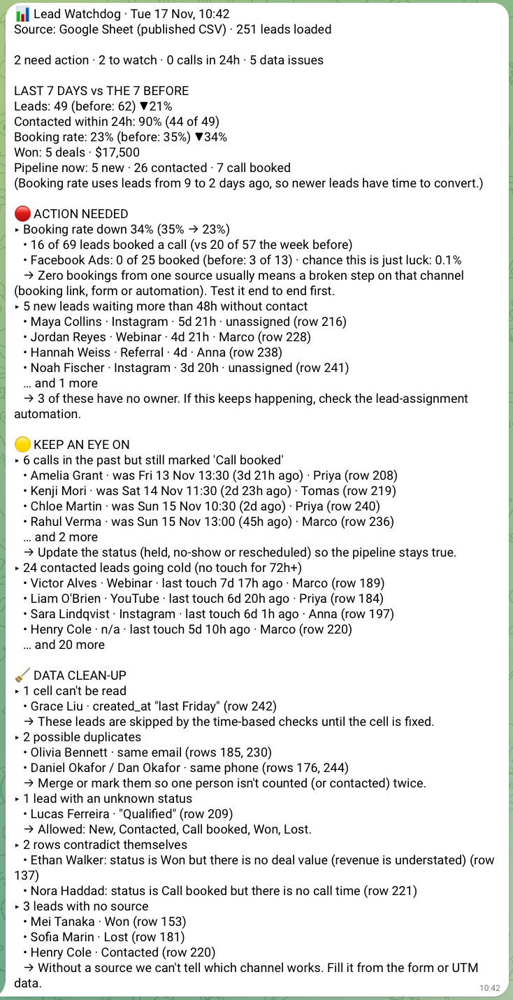
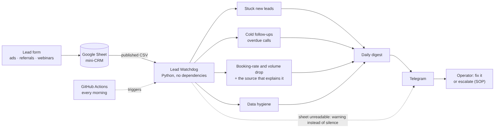

# Lead Watchdog

A small monitoring bot for a lead-to-sale funnel. Every morning it reads the lead sheet, finds what a busy operator would miss, and sends a short digest to Telegram: stuck leads, cold follow-ups, overdue calls, a drop in bookings **with the channel that explains it**, and messy data.

> **The demo data is synthetic.** Every person, e-mail and phone number in `data/leads_demo.csv` is invented. The story inside it (the booking link of one ad channel "breaks") is planted on purpose, to show what the checks do. This project has not been run against a real business yet.

## Why this exists

In a business that lives on inbound leads (coaching, education, service agencies) money leaks quietly: a lead nobody answers for two days, a booking link that stops working on one ad channel, a spreadsheet where half the rows have no source. Nobody notices until the monthly report.

Lead Watchdog looks at the numbers every morning so a person doesn't have to, and it says **what to look at first**. The companion [SOP](docs/SOP_alert_response.md) says what to do about each alert, and when to fix it yourself versus bring it to the founder.

## What it checks

| Check | Fires when (defaults) | Why it matters |
|---|---|---|
| Stuck new lead | status `New`, no contact for more than 24h (more than 48h = critical) | speed to lead often decides who wins the deal |
| Going cold | status `Contacted`, untouched for more than 72h | follow-up is where deals get lost |
| Overdue call | `Call booked`, call time passed by more than 2h, status never updated | keeps the pipeline true, no-shows get rebooked |
| Upcoming calls | `Call booked` in the next 24h | the day's prep list |
| Booking-rate drop | booking rate down 20%+ vs the previous week (40%+, or a dead source = critical) | the earliest sign of a broken funnel |
| ...and its cause | the source whose drop is unlikely to be luck (under 5% chance) | tells you where to look first |
| Volume drop | new leads down 30%+ vs the previous week | ads, tracking or form problems |
| Data hygiene | duplicates, missing source, unknown status, contradictory rows, unreadable cells, dates in the future | bad data silently breaks every number above |

## Sample output

Produced by `python -m leadwatch --now "2026-11-12 09:00"` on the demo data:

```text
📊 Lead Watchdog · Thu 12 Nov, 09:00
Source: leads_demo.csv · 240 leads loaded

2 need action · 3 to watch · 3 calls in 24h · 5 data issues

LAST 7 DAYS vs THE 7 BEFORE
Leads: 62 (before: 59) ▲5%
Contacted within 24h: 93% (50 of 54)
Booking rate: 24% (before: 35%) ▼31%
Won: 7 deals · $21,500
Pipeline now: 4 new · 26 contacted · 9 call booked
(Booking rate uses leads from 9 to 2 days ago, so newer leads have time to convert.)

🔴 ACTION NEEDED
▸ Booking rate down 31% (35% → 24%)
   • 14 of 58 leads booked a call (vs 20 of 57 the week before)
   • Facebook Ads: 0 of 16 booked (before: 4 of 13) · chance this is just luck: 0.3%
   → Zero bookings from one source usually means a broken step on that channel (booking link, form or automation). Test it end to end first.
▸ 2 new leads waiting more than 48h without contact
   • Maya Collins · Instagram · 3d 4h · unassigned (row 206)
   • Jordan Reyes · Webinar · 2d 4h · Marco (row 217)
   → 1 of these has no owner. If this keeps happening, check the lead-assignment automation.

🟡 KEEP AN EYE ON
▸ 2 new leads waiting more than 24h without contact
   • Hannah Weiss · Referral · 31h · Anna (row 229)
   • Noah Fischer · Instagram · 27h · unassigned (row 231)
   → 1 of these has no owner. If this keeps happening, check the lead-assignment automation.
▸ 2 calls in the past but still marked 'Call booked'
   • Amelia Grant · was yesterday 11:30 (21h ago) · Priya (row 202)
   • Kenji Mori · was yesterday 16:00 (17h ago) · Tomas (row 207)
   → Update the status (held, no-show or rescheduled) so the pipeline stays true.
▸ 3 contacted leads going cold (no touch for 72h+)
   • Victor Alves · Webinar · last touch 5d ago · Marco (row 195)
   • Liam O'Brien · YouTube · last touch 4d 3h ago · Priya (row 186)
   • Sara Lindqvist · Instagram · last touch 3d 8h ago · Anna (row 196)

📅 CALLS IN THE NEXT 24H
   • today 11:00 · Chloe Martin · Priya · Referral
   • today 14:00 · Rahul Verma · Marco · Webinar
   • today 17:00 · Elise Fournier · Anna · Instagram

🧹 DATA CLEAN-UP
▸ 1 cell can't be read
   • Grace Liu · created_at "last Friday" (row 232)
   → These leads are skipped by the time-based checks until the cell is fixed.
▸ 2 possible duplicates
   • Olivia Bennett · same email (rows 187, 218)
   • Daniel Okafor / Dan Okafor · same phone (rows 168, 233)
   → Merge or mark them so one person isn't counted (or contacted) twice.
▸ 1 lead with an unknown status
   • Lucas Ferreira · "Qualified" (row 203)
   → Allowed: New, Contacted, Call booked, Won, Lost.
▸ 2 rows contradict themselves
   • Ethan Walker: status is Won but there is no deal value (revenue is understated) (row 138)
   • Nora Haddad: status is Call booked but there is no call time (row 209)
▸ 3 leads with no source
   • Mei Tanaka · Won (row 148)
   • Sofia Marin · Lost (row 178)
   • Henry Cole · Contacted (row 208)
   → Without a source we can't tell which channel works. Fill it from the form or UTM data.
```



Every alert names the rows involved, so any number can be checked by filtering the sheet.

## How it works



Design decisions worth knowing:

1. **Watch the watcher.** If the sheet can't be read (link changed, columns renamed), the bot sends a warning instead of staying silent. A monitor that quietly checks nothing is worse than none.
2. **Conversion is measured on leads old enough to convert.** A lead created yesterday hasn't had time to book a call, so "last 7 days vs the 7 before" would always look like a drop. Conversion windows are shifted back by 2 days; lead *volume* uses the plain last 7 days.
3. **Luck check.** A source is blamed only if its drop has less than a 5% chance of being random (a binomial test). Small samples wobble, and an alert that cries wolf gets muted.
4. **Overall numbers hide dead channels**, so the drop is always broken down by source.
5. **Privacy by default.** With `--send` the digest goes to Telegram and *not* to the log (CI logs can be public); contact details are used for duplicate detection but never printed; the sheet link and bot token never appear in messages or errors.
6. **Zero dependencies.** Python 3.9+ standard library only, so it runs anywhere.
7. **Time is an input.** `--now "2026-11-12 09:00"` pins the clock, which makes demos and tests reproducible.

## Quick start (demo data, nothing is sent)

```bash
python -m unittest discover -v                    # 53 tests
python -m leadwatch --now "2026-11-12 09:00"      # reproduces the sample output above
```

(`python3` on macOS/Linux, `py` on Windows.) The committed demo data is anchored at 2026-11-12 09:00, so pin the clock with `--now` as above. For a digest relative to *today*, generate fresh data first:

```bash
python scripts/make_demo_data.py      # rewrites data/leads_demo.csv, anchored at the current time
python -m leadwatch
```

## Use it with a real Google Sheet

1. Put leads in a sheet with these columns (a Google Form's `Timestamp` and `Email Address` columns work as they are):

   | Column | Required | Notes |
   |---|---|---|
   | `created_at` | yes | `yyyy-mm-dd hh:mm`; also reads `dd.mm.yyyy` and `mm/dd/yyyy` |
   | `status` | yes | `New`, `Contacted`, `Call booked`, `Won`, `Lost` |
   | `lead_id`, `name` | no | used in the digest |
   | `email`, `phone` | no | duplicate detection only, never printed |
   | `source` | recommended | enables the per-source breakdown |
   | `owner` | no | who to chase |
   | `first_contact_at`, `last_contact_at` | recommended | speed-to-lead and cold follow-ups |
   | `call_at` | no | calls and booking rate |
   | `deal_value` | no | revenue |

2. **File > Share > Publish to web**, choose the sheet, format **CSV**, Publish, copy the link.
3. Put it in `.env` as `LEADWATCH_SOURCE=<link>` and run `python -m leadwatch`.

> A published link is readable by anyone who has it. Don't publish a sheet with real personal data this way; use a copy with only the columns above, or extend the loader with a service account.

## Telegram

1. Create a bot with [@BotFather](https://t.me/BotFather) and copy the token.
2. `cp .env.example .env` and set `TELEGRAM_BOT_TOKEN`.
3. Send any message to your bot, then run `python -m leadwatch --find-chat` and copy the chat id into `.env`.
4. `python -m leadwatch --ping` checks the connection. `python -m leadwatch --send --print` sends the digest.

## Run it every morning

`.github/workflows/daily-digest.yml` runs the digest daily at 08:00 (Minsk time) on GitHub Actions. Add `TELEGRAM_BOT_TOKEN`, `TELEGRAM_CHAT_ID` and `LEADWATCH_SOURCE` under *Settings > Secrets and variables > Actions*, then start it once from the *Actions* tab. Until `LEADWATCH_SOURCE` is set, the workflow generates fresh demo data and sends that digest. Scheduled workflows are paused after 60 days without repository activity.

## Settings

| Setting | Where | Default |
|---|---|---|
| `LEADWATCH_SOURCE` / `--source` | env / flag | `data/leads_demo.csv` |
| `LEADWATCH_UTC_OFFSET` | env | `3` (hours between UTC and the sheet's timezone) |
| `LEADWATCH_SLA_HOURS` / `--sla-hours` | env / flag | `24` |
| Other thresholds | `leadwatch/config.py` | see the table above |

Flags: `--send`, `--print`, `--ping`, `--find-chat`, `--now`, `--version`.

## Tests

```bash
python -m unittest discover -v         # 53 tests, a fraction of a second
python scripts/mutation_check.py       # injects 8 bugs on purpose; the suite must catch all 8
```

- Most expected values are worked out by hand inside the test (a 4-lead week with 2 bookings is 50%).
- Boundaries are tested exactly (24h is fine, 24h 1min is not).
- Headline numbers of the demo digest are recounted straight from the CSV with the `csv` module, without using the project's code.
- Telegram and Google Sheets calls are tested with fakes. They have **not** been exercised against the live services here, so run `--ping` on your own setup.

## Project layout

```text
leadwatch/
  loader.py     reads the sheet (file or published CSV); bad cells become issues, bad sheets raise
  metrics.py    time windows, funnel counts, per-source breakdown, the luck check
  checks.py     the monitors, one small function each
  report.py     builds the digest and splits it for Telegram
  telegram.py   minimal Bot API client (token never appears in errors)
  cli.py        the command line
scripts/        demo-data generator, bug-injection check
tests/          53 tests
docs/           SOP for alert response, system map, how AI was used
```

## Limits and next steps

- Demo data only; thresholds are defaults and should be tuned with the people who work the leads.
- A deal is dated by its closing call (there is no "closed at" column). No-show rate is not tracked yet.
- Runs once a day, so it is a morning briefing, not a real-time alarm.
- Next: show rate, a per-owner view, writing alerts back into the CRM, Slack output.

## How this was built

With AI assistance (Claude): the AI drafted the code, tests and docs; the verification above (hand-computed tests, injected bugs, independent recount) is what turns a draft into something to trust. Details in [docs/AI_WORKFLOW.md](docs/AI_WORKFLOW.md).
