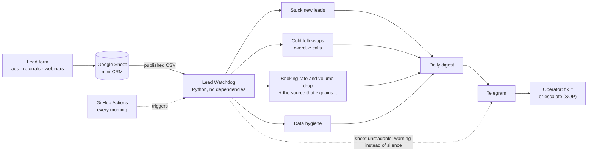

# System map

## Components

| Part | What it does | Where |
|---|---|---|
| Lead sheet | One row per lead: the mini-CRM and the only input | Google Sheet (published as CSV) or a local CSV |
| Loader | Reads the sheet, tolerates messy cells, refuses a sheet that doesn't look like a lead sheet | `leadwatch/loader.py` |
| Metrics | Time windows, funnel counts, per-source breakdown, luck check | `leadwatch/metrics.py` |
| Checks | The monitors: stuck leads, cold follow-ups, overdue calls, funnel drops, data hygiene | `leadwatch/checks.py` |
| Digest | One short message, grouped by urgency | `leadwatch/report.py` |
| Telegram sender | Delivers the digest, splits long messages | `leadwatch/telegram.py` |
| Scheduler | GitHub Actions cron, 08:00 | `.github/workflows/daily-digest.yml` |
| SOP | What to do about each alert, and when to escalate | `docs/SOP_alert_response.md` |

## Data contract (the lead sheet)

| Column | Required | Format | Used for |
|---|---|---|---|
| `created_at` | yes | `yyyy-mm-dd hh:mm` (also `dd.mm.yyyy`, `mm/dd/yyyy`) | every time window |
| `status` | yes | `New`, `Contacted`, `Call booked`, `Won`, `Lost` | pipeline and checks |
| `lead_id` | no | text | row identity (falls back to the row number) |
| `name` | no | text | wording of the digest |
| `email`, `phone` | no | text | duplicate detection only, never printed |
| `source` | recommended | text | per-source breakdown |
| `owner` | no | text | who to chase |
| `first_contact_at` | recommended | datetime | speed to lead |
| `last_contact_at` | recommended | datetime | cold follow-ups |
| `call_at` | no | datetime | calls and booking rate |
| `deal_value` | no | number (`$2,500` works) | revenue |

Assumptions made explicit: sheet times are in one timezone (`LEADWATCH_UTC_OFFSET`); ambiguous slash dates are read month first; a deal is dated by its closing call.
